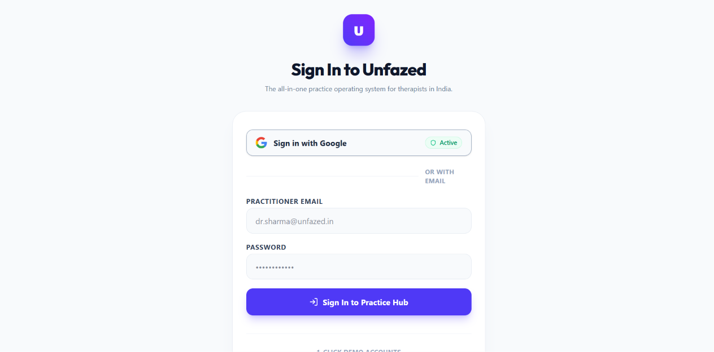
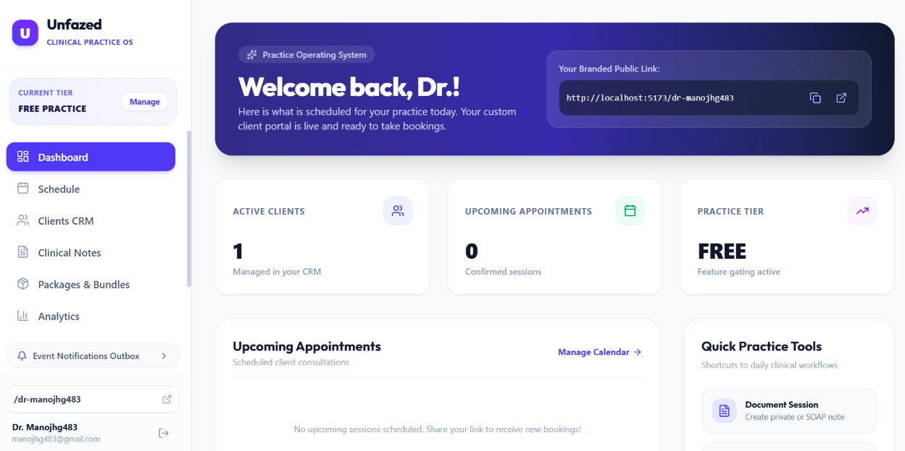
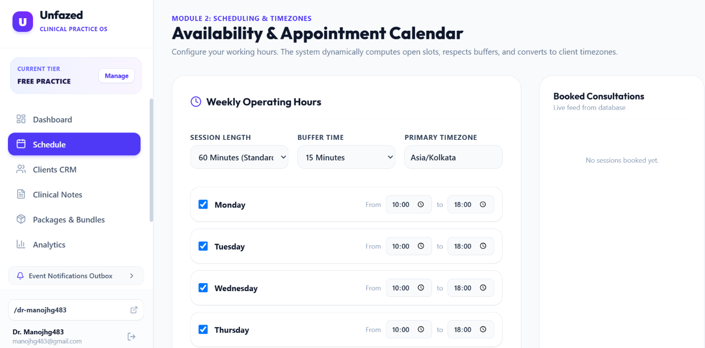
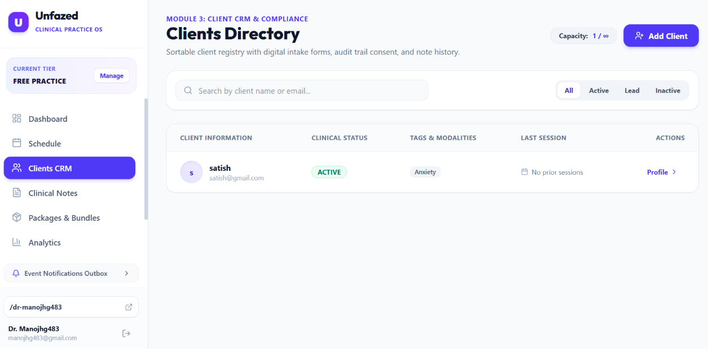
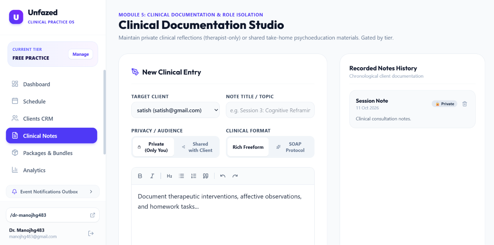
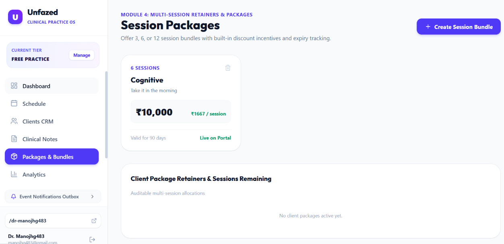
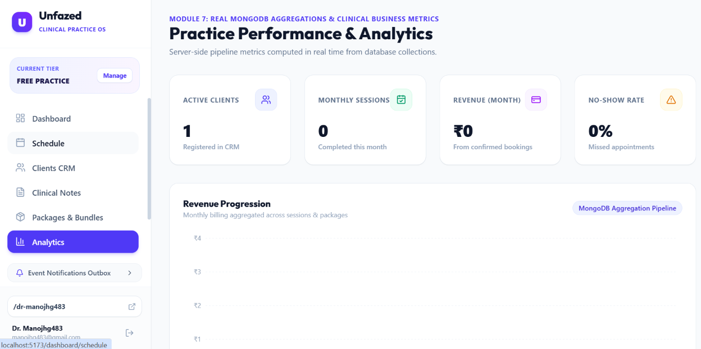
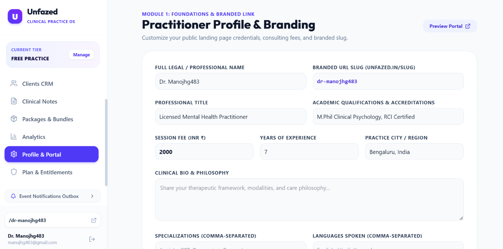
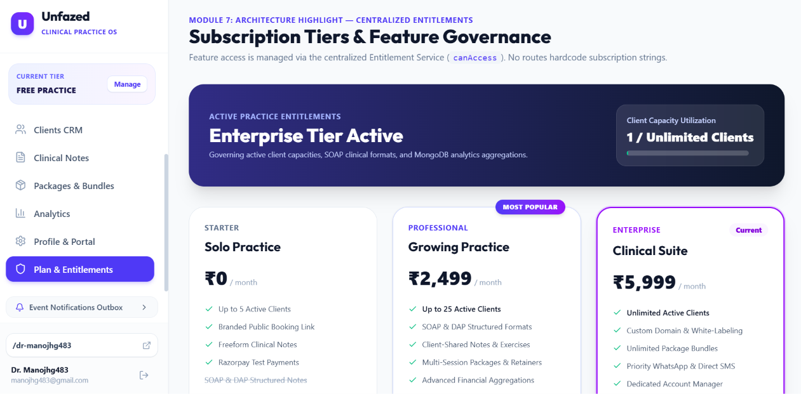

# Unfazed — Clinical Practice Operating System for Therapists in India 🌿

[](https://unfazed-saa-s.vercel.app)
[](https://react.dev/)
[](https://tailwindcss.com/)
[](https://nodejs.org/)
[](https://www.mongodb.com/)
[](https://unfazed-saa-s.vercel.app/login)

**Unfazed** is a full-stack, enterprise-grade SaaS platform built specifically for mental health practitioners in India. It empowers therapists to run their entire private practice — client acquisition, timezone-aware scheduling, digital consent intake, Razorpay payments with GST-compliant tax invoices, SOAP/DAP clinical documentation, real-time Socket.io chat, and business analytics — through **one branded public link** (e.g., `unfazed.in/dr-sharma`).

---

## 🌐 Live Production Deployment

- **Live Frontend**: [https://unfazed-saa-s.vercel.app](https://unfazed-saa-s.vercel.app)
- **Live Practice Hub / Login**: [https://unfazed-saa-s.vercel.app/login](https://unfazed-saa-s.vercel.app/login)
- **GitHub Repository**: [https://github.com/manoj-hg/Unfazed_SaaS](https://github.com/manoj-hg/Unfazed_SaaS)

> **Evaluator Quick Test**: Anyone can click **"Sign in with Google"** on the login page to immediately test the platform. It features instant practitioner provisioning, pre-seeded accounts (**Dr. Ananya Sharma** - Pro Tier, **Dr. Rohan Mehta** - Free Tier, **Manoj H G** - Owner), and accepts **any Google/Gmail account** without domain-restriction roadblocks.

---

## 📸 Platform Tour & Visual Walkthrough

### 1. Universal Google Sign-In & Instant Onboarding
*Dual-engine Google OAuth 2.0 authentication active for evaluators, reviewers, and practitioners worldwide with zero configuration friction.*


---

### 2. Practitioner Dashboard Hub
*Real-time overview of active clients, scheduled sessions, practice tier status, quick practice tools, and custom public link sharing.*


---

### 3. Timezone-Aware Scheduling & Operating Hours
*Module 2: Weekly schedule configuration, dynamic slot generation, custom buffer times (15m standard), and strict Asia/Kolkata timezone mapping.*


---

### 4. Client CRM & Digital Compliance Intake
*Module 3: Centralized client directory with real-time capacity monitoring, clinical status tracking (Active, Lead, Inactive), and digital consent history.*


---

### 5. Clinical Documentation Studio (SOAP / DAP & Privacy Isolation)
*Module 5: TipTap rich-text clinical studio featuring rigid role-based privacy isolation (Therapist-Only Private Notes vs. Client-Shared Take-Home Psychoeducation).*


---

### 6. Multi-Session Retainers & Discount Bundles
*Module 4: Creation of 3, 6, or 12-session prepaid therapy bundles with per-session savings calculations and remaining balance auditing.*


---

### 7. Real MongoDB Aggregation Analytics
*Module 7: Real-time business intelligence calculated on MongoDB aggregation pipelines — tracking monthly revenue progression, active clients, and no-show rates.*


---

### 8. Practitioner Profile & Custom Branded Link
*Module 1: Custom branded profile builder (`unfazed.in/:slug`) showcasing credentials, RCI certifications, consultation fees, bio, and languages.*


---

### 9. Subscription Tiers & Centralized Entitlements Gating
*Module 7: Config-driven subscription tier governance (`canAccess`) enforcing limits across Free (5 clients), Pro (25 clients), and Enterprise (Unlimited) tiers.*


---

## 🏛️ System Architecture & Major Modules

```
┌─────────────────────────────────────────────────────────────┐
│                      Client Experience                      │
│        (Branded Portal, Intake, Booking, Telehealth)        │
└──────────────────────────────┬──────────────────────────────┘
                               │
┌──────────────────────────────▼──────────────────────────────┐
│                    Therapist Practice Hub                   │
│        (Calendar, CRM, SOAP Notes, Billing, Analytics)      │
└──────────────────────────────┬──────────────────────────────┘
                               │
┌──────────────────────────────▼──────────────────────────────┐
│                  Centralized Entitlement Layer              │
│       canAccess(therapistId, featureKey) [Config-driven]     │
└──────────────────────────────┬──────────────────────────────┘
                               │
┌──────────────────────────────▼──────────────────────────────┐
│                       Express 5 API                         │
│   Auth • Scheduling • Clients • Notes • Payments • Packages │
└──────────────────────────────┬──────────────────────────────┘
                               │
┌──────────────────────────────▼──────────────────────────────┐
│                    MongoDB Cloud Datastore                  │
│       Compound Indexes • Aggregations • Audit Logs          │
└─────────────────────────────────────────────────────────────┘
```

### Module Breakdown
1. **Module 1: Authentication & Branded Public Profile**
   - Universal Google OAuth 2.0 with instant practice provisioning and slug generation (`/dr-name`).
   - Branded public client portal featuring clinical bio, RCI credentials, specializations, and booking widget.
2. **Module 2: Timezone-Aware Scheduling & Booking Engine**
   - Dynamic weekly availability matrix with configurable buffer times.
   - Compound index slot locking (`{ therapist_id: 1, start_time: 1 }`) to eliminate double-booking.
   - Automatic timezone conversions (`date-fns-tz` with `Asia/Kolkata` baseline).
3. **Module 3: Client CRM & Compliance Intake**
   - Full clinical history, contact records, and therapy modality tags.
   - Built-in digital informed consent and medical history intake forms with audit timestamps.
4. **Module 4: Razorpay Payments & Multi-Session Packages**
   - Seamless checkout for single sessions or 3/6/12 session retainers.
   - SAC 999312 compliant PDF tax invoice streaming powered by `pdfkit`.
5. **Module 5: Clinical Documentation Studio**
   - Strict role-based isolation: **Private Notes** (accessible only by the practitioner) vs. **Shared Notes** (accessible to clients).
   - Structured SOAP (Subjective, Objective, Assessment, Plan) and DAP clinical templates.
6. **Module 6: Real-time Communication & Notifications**
   - Socket.io bidirectional real-time messaging with room isolation, read receipts, and typing indicators.
   - Domain event notification outbox for transactional email and WhatsApp dispatch auditing.
7. **Module 7: Centralized Entitlement Service & Analytics**
   - Config-driven tier gating (`Starter/Free`, `Professional`, `Enterprise`) via single source of truth `canAccess()`.
   - Real-time practice analytics powered by native MongoDB `$group`, `$match`, and `$facet` aggregation pipelines.

---

## 🛠️ Technology Stack

| Layer | Technologies |
| :--- | :--- |
| **Frontend** | React 19, Vite, Tailwind CSS v4, React Router 7, TipTap Rich-Text, Recharts, Lucide Icons |
| **Backend** | Node.js, Express 5, Socket.io, JWT Authentication, PDFKit, date-fns-tz |
| **Database** | MongoDB (Mongoose 8) with Compound Indexes & Aggregation Pipelines |
| **External Services** | Google Identity Services (OAuth 2.0), Razorpay Gateway, MongoDB Atlas |
| **Hosting & CI/CD** | Vercel (Frontend), Render (Backend), GitHub Actions / Blueprints |

---

## 🚀 Running Locally

### Prerequisites
- Node.js (v18.0.0 or higher)
- Local MongoDB running on `127.0.0.1:27017` (or a MongoDB Atlas connection URI)

### 1. Clone the Repository
```bash
git clone https://github.com/manoj-hg/Unfazed_SaaS.git
cd Unfazed_SaaS
```

### 2. Backend Setup
```bash
cd unfazed-backend
npm install

# Seed the database with sample therapists, tiers, clients & appointments:
npm run seed

# Start the development server:
npm run dev
# Running on http://localhost:5000
```

### 3. Frontend Setup
Open a new terminal window:
```bash
cd unfazed-frontend
npm install

# Start the Vite development server:
npm run dev
# Running on http://localhost:5173
```

---

## 📦 Default Seed Accounts for Testing

| Account | Email | Password | Tier | Portal Link |
| :--- | :--- | :--- | :--- | :--- |
| **Dr. Ananya Sharma** | `ananya@unfazed.in` | `Password123!` | Pro Practice | `http://localhost:5173/dr-sharma` |
| **Dr. Rohan Mehta** | `rohan@unfazed.in` | `Password123!` | Free Practice | `http://localhost:5173/dr-rohan` |
| **Manoj H G** | `manoj.hg@gmail.com` | Google 1-Click | Practice Admin | `http://localhost:5173/dr-manoj-h-g` |

---

## 📄 License & Attribution

Designed and developed by **Manoj H G** as a comprehensive SaaS Major Project for Web Development.
All clinical documentation formats, GST invoice structures, and entitlement schemas adhere to telehealth standards in India.
